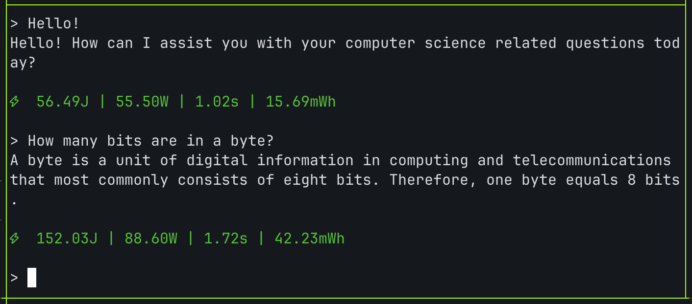

# neuralwatt-tools

[](https://github.com/neuralwatt/neuralwatt-tools/actions/workflows/ci.yml)
[](https://www.python.org/downloads/)
[](LICENSE)
[](https://discord.gg/ZJEfU2BZw2)

Tools for the [Neuralwatt](https://neuralwatt.com) inference API: a usage CLI, an `llm` plugin that shows the energy each request used, a Neovim energy monitor and a tmux status line.

Setup guides for coding agents and chat apps (Claude Code, OpenCode, Codex, Hermes Agent, pi, oh-my-pi, OpenClaw, Open WebUI and others) are in the Neuralwatt docs at [docs.neuralwatt.com/integrations](https://docs.neuralwatt.com/integrations/overview).



## What is Neuralwatt?

[Neuralwatt](https://neuralwatt.com) builds software for energy-efficient AI infrastructure. As part of this, we run a hosted inference API at [portal.neuralwatt.com](https://portal.neuralwatt.com).

The API serves OpenAI Chat Completions, OpenAI Responses and Anthropic Messages, so it works with most tools that let you set a custom base URL.

Every response also reports the energy the request used, alongside the standard token counts:

```json
{
  "usage": {
    "prompt_tokens": 10,
    "completion_tokens": 3,
    "total_tokens": 13
  },
  "energy": {
    "energy_joules": 60.37,
    "energy_kwh": 0.00001677,
    "avg_power_watts": 3755.0,
    "duration_seconds": 0.083
  }
}
```

## Tools

Get your API key from [portal.neuralwatt.com](https://portal.neuralwatt.com), then pick a tool:

| Tool | What it does | Get started |
|-|-|-|
| [nw-usage](scripts/) | Prints today's requests and energy, for a terminal or status line | [nw-usage README](scripts/README.md) |
| [llm plugin](plugins/llm-neuralwatt/) | Adds Neuralwatt models to [simonw/llm](https://llm.datasette.io/) and prints energy per request | [Plugin README](plugins/llm-neuralwatt/README.md) |
| [Pi MCR extension](plugins/pi/) *(private beta)* | Unlock 1M virtual context in [Pi](https://pi.dev) via Neuralwatt MCR | [Setup guide](plugins/pi/README.md) |
| [Build your own MCR client](docs/mcr-context-drop-client-protocol.md) | Integrate MCR context management into any OpenAI-/Anthropic-compatible client | [Protocol spec](docs/mcr-context-drop-client-protocol.md) |
| [Neovim](recipes/neovim/) | Energy monitor in a floating window, plus a codecompanion.nvim config | [Neovim recipe](recipes/neovim/README.md) |
| [tmux](recipes/tmux/) | Today's usage in the status bar | [tmux recipe](recipes/tmux/README.md) |

## What's Inside

```
neuralwatt-tools/
├── scripts/
│   ├── nw-usage             # Usage CLI
│   └── install-nw-usage     # Installs nw-usage and an OpenCode /nw-usage command
├── plugins/
│   ├── llm-neuralwatt/      # pip-installable llm plugin
│   └── pi/                  # Pi MCR extension (1M virtual context)
└── recipes/
    ├── neovim/              # Energy monitor and codecompanion.nvim config
    ├── tmux/                # Status line
    └── ...                  # Older tool recipes, now pointers to the docs site
```

## Using with Any OpenAI-Compatible Tool

Point the tool at `https://api.neuralwatt.com/v1` and use your Neuralwatt key. With the OpenAI Python SDK:

```python
from openai import OpenAI

client = OpenAI(base_url="https://api.neuralwatt.com/v1", api_key="your-api-key-here")
response = client.chat.completions.create(
    model="nw-flash",
    messages=[{"role": "user", "content": "Reply with the single word: ok"}],
)
print(response.choices[0].message.content)
```

Many tools also read these environment variables:

```bash
export OPENAI_BASE_URL="https://api.neuralwatt.com/v1"
export OPENAI_API_KEY="your-api-key"
```

`nw-flash` is a [tracking alias](https://docs.neuralwatt.com/guides/tracking-aliases), which we move to a newer model when one ships. To pin a model, use its ID, such as `kimi-k3.1-pro`. `GET https://api.neuralwatt.com/v1/models` lists every model ID. [Any other tool](https://docs.neuralwatt.com/integrations/overview#any-other-tool) in the docs has the base URLs for the Responses and Anthropic Messages APIs, and settings some tools need changed.

## Links

- [docs.neuralwatt.com](https://docs.neuralwatt.com): API reference and setup guides
- [portal.neuralwatt.com](https://portal.neuralwatt.com): Hosted inference API (get your API key here)
- [neuralwatt.com](https://neuralwatt.com): Core product, energy efficiency software for AI infrastructure

## Community

Join us on [Discord](https://discord.gg/ZJEfU2BZw2) for questions, feedback, and discussions.

## Contributing

PRs to the tools here are welcome. To ask for a setup guide for another tool, open an issue or ask on Discord.

## License

Apache-2.0
