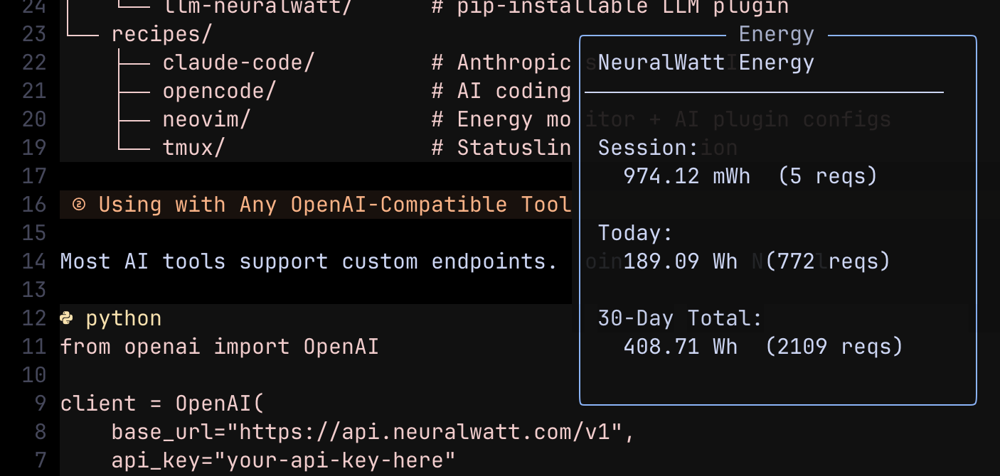

# Neovim with Neuralwatt

Two ways to use Neuralwatt in Neovim:

1. **Energy Monitor** - Track your Neuralwatt API usage in a floating window
2. **AI Completions** - Use Neuralwatt as the backend for coding assistant plugins

## Energy Monitor

A Lua module that polls the Neuralwatt usage API and displays energy stats.



### Installation

Copy `energy-monitor.lua` to your Neovim config:

```bash
mkdir -p ~/.config/nvim/lua/neuralwatt
cp energy-monitor.lua ~/.config/nvim/lua/neuralwatt/init.lua
```

### Setup

Create the API key file. [`nw-usage`](../../scripts/) reads the same file.

```bash
mkdir -p ~/.config/neuralwatt
echo "your-api-key-here" > ~/.config/neuralwatt/api_key
chmod 600 ~/.config/neuralwatt/api_key
```

Add to your Neovim config (e.g., `init.lua`). These are the defaults, so `require("neuralwatt").setup()` does the same:

```lua
require("neuralwatt").setup({
  api_key_file = vim.fn.expand("~/.config/neuralwatt/api_key"),
  poll_interval_ms = 30000,  -- 30 seconds
  auto_start = true,
})
```

The monitor shows three figures: usage since Neovim started, today, and the last 30 days. "Today" is the current UTC day, because the usage API groups requests by UTC day.

### Commands

| Command | Description |
|---------|-------------|
| `:NeuralwattEnergy` | Show full stats in a floating window |
| `:NeuralwattMini` | Toggle mini stats in corner |
| `:NeuralwattNotify` | Show stats as notification |

### Key Bindings (Optional)

```lua
vim.keymap.set('n', '<leader>ne', ':NeuralwattEnergy<CR>', { desc = 'Neuralwatt energy stats' })
vim.keymap.set('n', '<leader>nm', ':NeuralwattMini<CR>', { desc = 'Neuralwatt mini toggle' })
```

---

## AI Completions

Neuralwatt serves the OpenAI Chat Completions API, so any Neovim plugin that can use an OpenAI-compatible provider can use Neuralwatt. For [codecompanion.nvim](https://github.com/olimorris/codecompanion.nvim), extend its `openai_compatible` adapter. This config needs codecompanion v18.0.0 or later, the release that renamed `strategies` to `interactions`.

```lua
require("codecompanion").setup({
  adapters = {
    http = {
      neuralwatt = function()
        return require("codecompanion.adapters").extend("openai_compatible", {
          formatted_name = "Neuralwatt",
          env = {
            url = "https://api.neuralwatt.com",
            api_key = "NEURALWATT_API_KEY",
          },
          schema = {
            model = { default = "nw-flash" },
          },
        })
      end,
    },
  },
  interactions = {
    chat = { adapter = "neuralwatt" },
    inline = { adapter = "neuralwatt" },
  },
})
```

`api_key` names the environment variable that holds your key:

```bash
export NEURALWATT_API_KEY="your-api-key-here"
```

`nw-flash` is one of our [tracking aliases](https://docs.neuralwatt.com/guides/tracking-aliases). Any chat model from the [model catalog](https://portal.neuralwatt.com/models) works in its place, such as `kimi-k3.1-pro`.

For other plugins, use the base URL and settings in [Any other tool](https://docs.neuralwatt.com/integrations/overview#any-other-tool).
