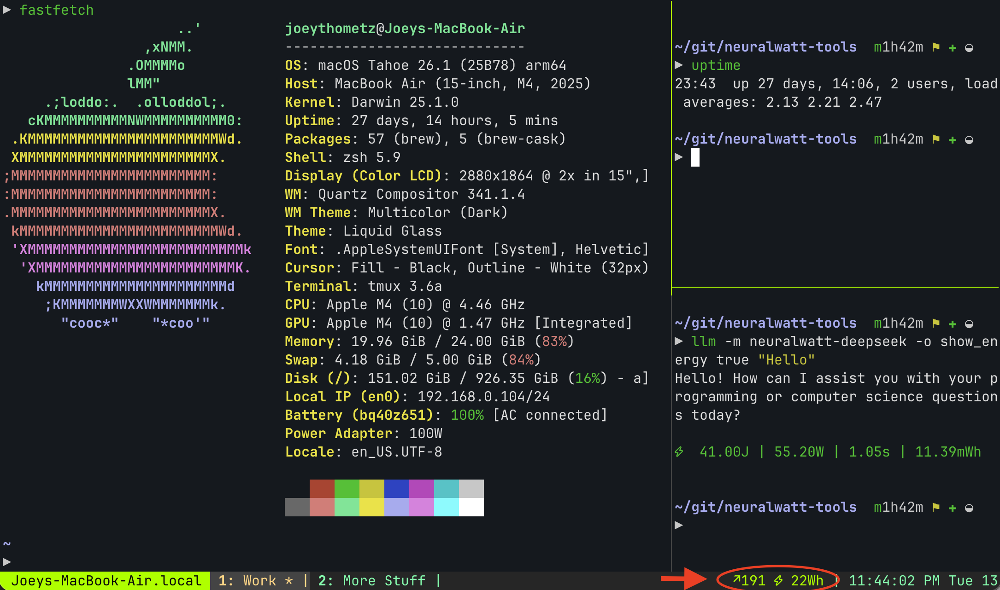

# Tmux Statusline with Neuralwatt

Show today's Neuralwatt request count and energy in the tmux status bar.



## Setup

1. Install the [`nw-usage`](../../scripts/) script. It needs `curl` and `jq`.

```bash
mkdir -p ~/.local/bin
curl -fsSL https://raw.githubusercontent.com/neuralwatt/neuralwatt-tools/main/scripts/nw-usage -o ~/.local/bin/nw-usage
chmod +x ~/.local/bin/nw-usage
```

2. Save your API key to a file. tmux runs status commands with the environment the tmux server started with, so a key exported in your shell later doesn't reach them. `nw-usage` reads this file when `NEURALWATT_API_KEY` is unset.

```bash
mkdir -p ~/.config/neuralwatt
echo "your-api-key-here" > ~/.config/neuralwatt/api_key
chmod 600 ~/.config/neuralwatt/api_key
```

3. Add to `~/.tmux.conf`:

```bash
set -g status-right '#[fg=colour154] #(~/.local/bin/nw-usage --tmux) #[fg=colour121]| %H:%M'
```

4. Reload tmux:

```bash
tmux source-file ~/.tmux.conf
```

## How It Works

The script calls `/v1/usage/energy` and prints today's figures as `↗<requests> ⚡<Wh>`, where today is the current UTC day. With `--tmux` it caches the result for one minute. See `nw-usage --help` for all options.
